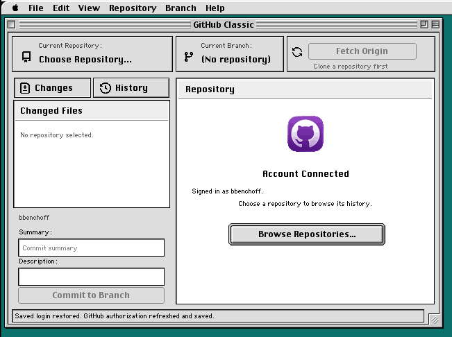
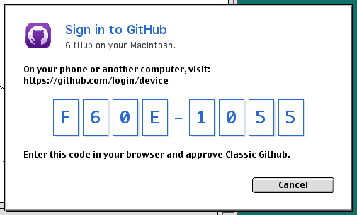
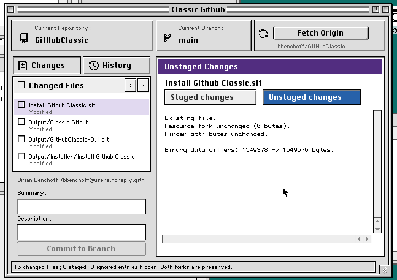
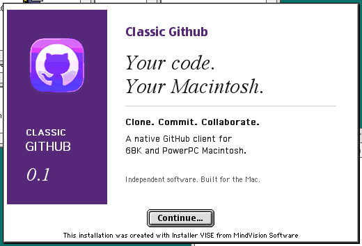

# Classic Github

A native GitHub client for Classic Mac OS, built for 68K and PowerPC with
System 7.5.3 through Mac OS 9.2.2 as compatibility targets. HTTPS and Git
operations run on the Macintosh itself. Release testing uses Mac OS 9.2.2
in QEMU; physical-machine qualification remains open.

<p align="center">
  
</p>

This repository is published with the application it contains, built with
CodeWarrior Pro 4 and run in QEMU. Reproducible checks and build instructions
are in [Maintenance](docs/MAINTENANCE.md). The full story is in the writeup:
**[Classic GitHub: A GitHub client for the Classic Macintosh OS](https://bbenchoff.com/pages/MacGitHub.html)**.

## What it does

- Clone, fetch, pull, push, branches, commits, diffs, stashes, merges, and
  linear rebases, implemented directly against Git's object model and
  packfile wire protocol. No proxy server, no port of command-line git.
- Verified HTTPS on the Macintosh itself: TLS 1.2 (ECDHE-RSA, P-256,
  AES-128-GCM) over Open Transport, with certificate chain, hostname, and
  date validation. The TLS library is a Classic Mac port of Mbed-TLS
  ([MacSSL](https://bbenchoff.com/pages/MacSSL.html)), bundled in `SRC`.
- GitHub sign-in by [Device Flow](https://docs.github.com/en/apps/oauth-apps/building-oauth-apps/authorizing-oauth-apps#device-flow):
  the Mac shows a code, you approve it on your phone. Your password and 2FA
  never touch the Macintosh. GitHub account passwords are not used as Git
  credentials.
- Saved authorization lives in an encrypted vault in
  `System Folder:Preferences` — AES-256-GCM, key derived from a separate
  local passphrase with PBKDF2-HMAC-SHA256. There is no master key compiled
  into the application.
- Fork-aware everything: commits, diffs, and status understand HFS resource
  forks and Finder metadata, not just the data fork.

<p align="center">
  
</p>

## Resource forks in an ordinary Git repository

Classic Mac files have two forks; Git blobs have one. Classic Github commits
the data fork under the file's real name — an ordinary blob anyone on Linux
or Windows can open, edit, and diff — and stores the resource fork and Finder
metadata under a reserved `.ghclient-mac` directory:

```
Hello.c
.ghclient-mac/
├── version
└── forks/
    └── 6f/
        └── 4d9a.../
```

A change made only to a resource fork is a real Git change. Checkout reverses
the process: the HFS file is recreated with both forks and its Finder
metadata. This repository uses the scheme itself — the C sources are plain
blobs, while the CodeWarrior project, interface resources, and built
applications keep their resource forks under `.ghclient-mac`.

**Clone this repository with Classic Github to get working Macintosh files.**
A normal `git clone` on a modern machine gives you readable sources but does
not reconstruct the forks. Modern contributors should use the
[companion maintenance tool](docs/MAINTENANCE.md#modern-host-file-renames-and-deletions)
when renaming or deleting files.

The native local `.git` directory uses an HFS-compatible layout specific to
Classic Github. Command-line Git cannot open that local store directly;
interoperability is through Git objects and the wire protocol. See
[Architecture and formats](docs/ARCHITECTURE.md).

<p align="center">
  
</p>

## Install

[Download the version 0.2 installer](Install%20Github%20Classic.sit), or the bare
[application archive](Output/GitHubClassic-0.2.sit). Get it onto your
Macintosh and expand it there. Keep **Classic Github** and **GHClient Login
Helper** in the same folder.

<p align="center">
  
</p>

First launch:

1. Choose **Help > Secure Networking Setup...**. On a fresh installation, the
   Set Up Secure Networking window opens. Existing setup is reused; the
   command shows Secure Networking Ready when it is ready for this session.
2. Smash the keyboard and move the mouse **inside the setup window**. Use
   different keys and vary your direction and pace. Allow at least 30
   seconds; Continue stays disabled until enough varied activity has been
   collected. This seeds the random state for TLS.
3. Click **Continue**, then choose and confirm a local vault passphrase of at least
   12 characters. This
   protects the network state and any saved login, and is separate from your
   GitHub password. Creating or unlocking the vault can take a while on a
   68K machine.
4. Choose **Help > Test GitHub Connection** to check Internet access and
   verified HTTPS. Setup itself runs locally and does not contact GitHub.
5. Open **File > Preferences** to sign in, and approve the Device Flow prompt
   on a phone or modern computer. No browser is needed on the Macintosh.

The built-in **Help > Classic Github Guide** repeats these steps. You can
return to Secure Networking Setup at any time; an existing setup does not
require collecting input again, though a locked vault may ask for its
passphrase.

For managed provisioning, Import Setup File accepts a fresh 64-byte
`.ghsetup` file; `SRC/Create Network Setup.html` is an optional offline
generator for modern computers. Generate a separate file for each Macintosh
and transfer it in binary mode. Never distribute a shared setup seed or a
pre-created vault.

## Building from source

`SRC` contains the CodeWarrior Pro 4 project, C sources, the bundled TLS
library, editable interface resources, and third-party license notices.
Sources retain Macintosh text encoding and line endings.

Open `SRC/Classic Github.mcp` in CodeWarrior Pro 4, choose the FAT MacOS
Toolbox target, and Make. The installed classic Mac SDK and CodeWarrior
libraries are required. The project searches `SRC` recursively and writes to
the sibling `Output` folder. The FAT application is named Classic Github; its
Finder creator is `GHCl`. `GHLoginHelper.c` is the login helper entry point
and uses `LoginHelper.rsrc`.

`SRC/Installer` contains the Installer VISE 6 project, color and monochrome
PICT artwork, an editable artwork resource file, and the native Read Me.
Refresh its sources from the current `Output` and `SRC` folders before
building; the built installer lands in `Output/Installer`.

## Version 0.2

TLS Finished errors now stop the handshake; new commit metadata uses UTF-8;
new plain-file Finder defaults avoid Mac OS 9 extension-mapping conflicts;
and new vault/passphrase operations enforce the same minimum length. Routine
fast-forward pushes omit verified history already held by the remote branch.

The release also includes portable regression tests, generated-header inputs,
modern companion-file maintenance tools and disposable native merge fixtures.
See [release notes](docs/RELEASES.md) and [maintenance](docs/MAINTENANCE.md).

## Scope and limits

Tested in QEMU with Mac OS 9.2.2; physical 68040 and System 7.5.3 testing
remains open. Designed for 640×480, with monochrome cues and color on capable
displays. Anything slower than a fast Quadra is not a good time.

- History is first-parent, staging is whole-file, and rebase is linear.
- Transfers select one branch; submodule checkout is not supported.
- Rename detection uses exact content; merges with multiple best common
  ancestors are refused.
- Push prepares its pack on disk and uploads in 16 KiB chunks, with limits of
  128 MiB per outgoing pack and 256 MiB of history read while preparing.
  First pushes and force-with-lease pushes still send complete history;
  outgoing objects use uncompressed stored DEFLATE blocks.
- Fetch and Clone responses are buffered, with a 64 MiB body limit, a 64 MiB
  expanded-pack limit, and a 2 MiB per-object limit.
- The application requests 192 MiB preferred memory (8 MiB minimum); larger
  repositories need the preferred allocation. Quit before changing Memory
  settings in Finder Get Info.
- Active downloads have a ten-minute total allowance and show bytes received;
  stalled TLS I/O times out after two minutes without progress.

Completed checkout backups and loose objects are retained. There is no
repacking or garbage collection in 0.2; see the space-reclamation guidance
in [Maintenance](docs/MAINTENANCE.md#space-and-performance).

## Security notes

Read the writeup's caveats before trusting this with anything important: the
vault is honest cryptography, but this is one person's reimplementation, not
an audited product. The entropy collector relies on an unpredictable operator
and input-timing variation; its activity checks are not a measurement or
certification of min-entropy. QEMU verifies the workflow; physical Macintosh
timing validation remains open.

The distributed application uses the public OAuth Client ID in
`SRC/OAuthConfig.h`. It identifies Classic Github, not a particular
repository; each user approves the application with their own GitHub account
through Device Flow. Public repository access is requested by default, and
private access is an explicit option. Advanced token sign-in uses the
permissions of the token its user supplies — a token restricted to another
repository cannot grant access to this one. Keep personal access tokens and
client secrets out of source and release files.

Existing vaults remain readable. If an older vault uses fewer than 12
characters, use **Change Local Passphrase** before manually saving new
credentials. Classic Mac OS does not isolate unlocked helper/app memory
from other local software. The bundled TLS port remains Mbed TLS 2.28.9
with local fixes; this release is not a complete security audit.

## License

Independent software, not affiliated with GitHub. Third-party copyright and
license notices are in `SRC/LICENSES.txt` and the source headers.
